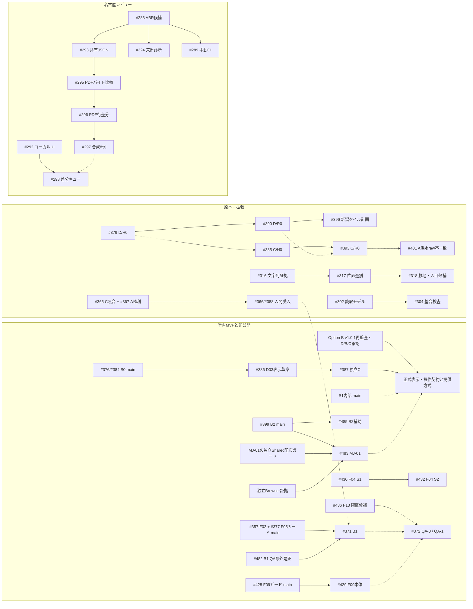

# HINANEX｜WP-001 開発資産棚卸し

2026-11-24 JST／司令塔受入待ち。学内MVPの目標日は2027-02-09、発表7分。

[新開発運用方針](HINANEX_DEVELOPMENT_OPERATING_MODEL_20261124.md) · [全OPEN PRの明細・変更ファイル・CI](HINANEX_WP001_OPEN_PRS_20261124.md)

## 調査時点と結論

- 調査のmainは `62557a665f59254755a696e2e89292035ea4f6c2`。GitHubのopen PR一覧とopen Issue一覧を100件単位で照合し、どちらも第2ページは空。Issue APIの95行からPR45件を除外し、**OPEN PR 45件（Draft 44）、OPEN Issue 50件**。ブランチ一覧は第1〜4ページ計380件で第5ページは空。うち**14件**のOPEN PRが非main base。集計にこの文書PRは含めない。基準 2026-11-24 15:01 JST。 [open PR](https://github.com/1kz-ma1/HINANEX/pulls) · [open Issue](https://github.com/1kz-ma1/HINANEX/issues) · [mainコミット](https://github.com/1kz-ma1/HINANEX/commit/62557a665f59254755a696e2e89292035ea4f6c2)
- 暫定分類は **MERGE候補 0／FIX候補 5／HOLD 11／DEFER候補 24／CLOSE候補 5**。全45件に同HEADの `test` SUCCESS試行が存在し、#365には同HEADのFAILも存在する。全45件は基準mainからbehindがあり、mainのpush CIはFAIL。更新と再検証は個別WPで行う。
- 使用した規範は [AGENTS.md](../../AGENTS.md)、[Merge Captain規約](../../.github/MERGE_CAPTAINS.md)、[main保護方針](../../.github/MAIN_PROTECTION.md)、[CONTRIBUTING.md](../../CONTRIBUTING.md)、[実機QA運用](HINANEX_IMPLEMENTATION_FIRST_DEVICE_QA_20261113.md)、[3軸ロードマップ](HINANEX_THREE_AXIS_ROADMAP_2027-02-09.md)。固定mainの再帰ツリーで `docs/` / `docs/strategy/` に追加AGENTSがないことを確認した。ブランチAPIはprotected、`test` 必須、enforcement everyoneを返す。保護詳細のAPIは403。詳細の証拠は当時の人間UI確認記録を参照する。 [#428 保護確認](https://github.com/1kz-ma1/HINANEX/pull/428#issuecomment-7122427126)
- GitHubのPR/Issue Conversation、GitHub review/thread、PRファイル、HEADごとのChecks、固定mainとの比較、関連統合済みPR、Renderメタデータとビルドログを照合。班員・旧チャットの提出報告は観測主体を明記する。旧サマリーの数値はGitHub/Renderの現在値へ流用しない。#465は現在もDraftで、既存の決裁本文と11/24追補の索引。001の統合前HOLDは当時の記録で、実行後の状態は#428の個別記録で更新されている。 [判断台帳PR #465](https://github.com/1kz-ma1/HINANEX/pull/465) · [統合後記録](https://github.com/1kz-ma1/HINANEX/pull/428#issuecomment-7123229517)

分類の意味。MERGE候補は現行ゲートを満たす候補。FIX候補は範囲を限定して再準備・再検証すれば判断可能。HOLDは依存、契約、承認または証拠の待ち。DEFER候補は学内MVPの中心体験に必須外。CLOSE候補は後継との重複または代替があり、固有の証拠を保全した上で司令塔が判断する。全分類は提案。

## #428統合後確認

| 項目 | 現在の証拠・判定 |
| --- | --- |
| main履歴 | GitHubのbranch/commit APIで最新main自体が `62557a665f59254755a696e2e89292035ea4f6c2`。#428は2026-11-24 14:43:55 JSTに統合。親 `331bd973f36f4c5032e8590214c912a85dc152bd`。 [PR #428](https://github.com/1kz-ma1/HINANEX/pull/428) |
| ガードのソース | 固定mainの `deploy/build_staging.py` blob `fdd260612086e6dd7b3a9c4140bc1d4e87640fba` とF09テスト blob `1b814cabc6407bf432049c58412db9f1d5fbcb77` は審査済みblobと一致。F09試作全ツリー・仕様・Node/Browser QA、F17試作全ツリーの除外が共存。F02/F03/F05既存除外も合成され、コピー後に対象が残ればビルドを停止する。 [固定ソース](https://github.com/1kz-ma1/HINANEX/blob/62557a665f59254755a696e2e89292035ea4f6c2/deploy/build_staging.py) |
| 統合前CI | #428 HEAD `3133d94e58f96b056a73d43ee0f984d94f9742f2` の必須 `test` SUCCESS。 [#45329851123](https://github.com/1kz-ma1/HINANEX/actions/runs/45329851123) |
| 統合後CI | `test.yml` はmain pushを起動対象とする。対象SHAのpush runは **FAIL**。Frontend 129 PASS / 1 FAIL、F02合成実HTTP Chromeの `null.innerText` 例外（`navigate` / `waitUntil`、テスト呼び出し427行）。後続のDeploy bundle / GIS等はSKIPPED。#428の差分はDeploy内2ファイルで、原因の断定には再現と親・#487の比較が必要。 [run #45335357917 / job #138246044052](https://github.com/1kz-ma1/HINANEX/actions/runs/45335357917/job/138246044052) · [workflow](https://github.com/1kz-ma1/HINANEX/blob/62557a665f59254755a696e2e89292035ea4f6c2/.github/workflows/test.yml) |
| WP-001独立のソース検証 | Windows/Python 3.13でGitHub取得した同blobのF09/F17既存ユニットテスト計4件を合成入力で実行し4 PASS。無関係なGSI公開importを呼出時に失敗するスタブへ差替え、通信なし。初回はsandbox既定一時ディレクトリで2件が書込権限エラー、workspace内 `TMPDIR` に切替え復帰。実Render成果物や全CIの再実行とは分けて扱う。 |
| Render実効状態 | `hinanex-staging` / `srv-db27rumk1f9s739evpbg`。main、On Commit、PR preview off、`deploy/dist`。deploy `dep-dc2i87dbedkc73b1i6bg` は対象SHAで **LIVE**（14:44:40 JST）。直前SHAはdeactivated。On CommitはCI成功を待つ設定と異なる。 [Renderサービス](https://dashboard.render.com/static/srv-db27rumk1f9s739evpbg) · [Render自動配信仕様](https://render.com/docs/deploys#configuring-auto-deploys) |
| 実配布境界 | Render build `bld-dc2i87dbedkc73b1i6c0` が対象SHAをcheckoutし `python deploy/build_staging.py` を完了、14:44:37 JSTに `HINANEX staging bundle ready`、`deploy/dist` をuploadしLIVE。既知パスに対するfail-closedの動作を、そのビルドについてログと固定ソースで確認。**実配布のパス別manifest・バイト・CDN応答はNOT_VERIFIED**。F09本体はmainに存在せず、F17はソース統合済み。過去版のキャッシュ、リライト、配信エッジ、別経路をログだけで判定しない。次の証拠は同deployの配布manifestまたは承認済み静的パスだけのボディなし応答と公開コントロール。実データGET・未承認の外部通信は対象外。 [元の司令塔記録](https://github.com/1kz-ma1/HINANEX/pull/428#issuecomment-7123229517) · [Render](https://dashboard.render.com/static/srv-db27rumk1f9s739evpbg) |

#428のmain統合条件は成立。#429の再準備、#371のガード修正、#483の独立配布保証は個別の作業。現時点の新規公開判断はNO-GO。

## 機能・仕様・既存統合の一覧

F01〜F19は [#346の将来仕様案](https://github.com/1kz-ma1/HINANEX/pull/346) の機能名で参照。MVP評価は [Owner採用 MJ-D01〜07](https://github.com/1kz-ma1/HINANEX/issues/362#issuecomment-7120366611) に従う。災害状況確認 → 明示的合成訓練 → 条件整理 → 根拠・未確認事項 → 最大2件の比較 → 本人による確認対象選択で完了。J02〜05は同一画面、公式と合成を完全分離、B1/B2/S0/S1を再利用し、S1表示／操作契約を分離。選択正本のS1集約は設計候補、MJ-D08提供方式はHOLD。

| 機能 | main・候補・学内MVP |
| --- | --- |
| F01 災害・洪水情報 | [#347](https://github.com/1kz-ma1/HINANEX/pull/347)、[#427](https://github.com/1kz-ma1/HINANEX/pull/427)、[#456](https://github.com/1kz-ma1/HINANEX/pull/456)、[#460](https://github.com/1kz-ma1/HINANEX/pull/460)、[#481](https://github.com/1kz-ma1/HINANEX/pull/481) がmain。公式/合成の出典と候補の根拠を区別。#489は補助UX。中心体験の状況確認に再利用。 |
| F02 施設参照 | [#351](https://github.com/1kz-ma1/HINANEX/pull/351)、[#357](https://github.com/1kz-ma1/HINANEX/pull/357)、[#370](https://github.com/1kz-ma1/HINANEX/pull/370)、[#402](https://github.com/1kz-ma1/HINANEX/pull/402)、[#479](https://github.com/1kz-ma1/HINANEX/pull/479) が統合。#491は補助。実施設の地理・権利・表示は#365/#367/#366。中心体験は合成限定でも成立可能。 |
| F03 事前入力 | [#306](https://github.com/1kz-ma1/HINANEX/pull/306) D基礎、[#359](https://github.com/1kz-ma1/HINANEX/pull/359) 隔離保存検証、[#368](https://github.com/1kz-ma1/HINANEX/pull/368) 配布ガード。#311保存基盤は別案。正式な端末保存なしでもMVPは成立可能。 |
| F04 洪水タイムライン | #430 S1／#432 S2の合成ローカル試作。独立Chrome記録あり。展示の追加候補で、現実予測は範囲外。 |
| F05 統合体験 | B1 #371は#482待ち。B2 [#399](https://github.com/1kz-ma1/HINANEX/pull/399)／[#405](https://github.com/1kz-ma1/HINANEX/pull/405)／[#419](https://github.com/1kz-ma1/HINANEX/pull/419)／[#477](https://github.com/1kz-ma1/HINANEX/pull/477) はmain、#485は補助。MJ-01 #483は中心候補。B1との実接続は未承認。 |
| F06 公式警報・避難情報 | [#352](https://github.com/1kz-ma1/HINANEX/pull/352)／[#353](https://github.com/1kz-ma1/HINANEX/pull/353) 統合。公式へのリンク境界を維持。現行の状況確認に再利用可能。 |
| F07 参考経路 | [#408](https://github.com/1kz-ma1/HINANEX/pull/408)／[#415](https://github.com/1kz-ma1/HINANEX/pull/415)／[#418](https://github.com/1kz-ma1/HINANEX/pull/418)／[#421](https://github.com/1kz-ma1/HINANEX/pull/421) 合成ローカル試作。現実経路は#358の条件待ち。MVP必須外。 |
| F08 オフライン | 限定的なローカル試作は存在。製品向けオフラインモードの採用・受入証拠未確認。MVP必須外。 |
| F09 備えチェックリスト | #428ガードのみmain、#429本体はDraft。保存しない非公開試作のP2を維持。 |
| F10 家族連絡 | 仕様案。製品の実装・採用証拠未確認。MVP必須外。 |
| F11 アクセシビリティ・多言語 | F01/F02/B2でキーボード整備例あり。主要フローの読み上げ・タップは#372。全面機能や多言語の受入は未確認。 |
| F12 お気に入り | 仕様案。正式な永続保存機能の採用・受入未確認。 |
| F13 データ状態表示 | F01既存の失敗/根拠表示と#436追加候補。Mac 75項目の限定証拠、QA-0隔離候補。特定のPR統合を中心体験の絶対条件にしない。 |
| F14 地域データ範囲 | RegionExport基盤あり。H0/R0の#379/#385/#390/#393/#396および3地域#264〜266、#272は追加審査。学内の1地域×洪水に必須外。 |
| F15 管理された証拠提供 | #342等の設計。製品としての採用・受入未確認。 |
| F16 災害後支援 | 仕様案。製品の実装・採用証拠未確認。 |
| F17 訓練 | [#437](https://github.com/1kz-ma1/HINANEX/pull/437) ガード、[#438](https://github.com/1kz-ma1/HINANEX/pull/438) 非公開の架空訓練がmain。独立した試作で、MJ-01・S0/S1との正式接続や一般公開は別判断。 |
| F18 避難所運営 | 仕様案。開設状況の事実や運営業務を実装済みと扱わない。 |
| F19 運用レビュー | 仕様案。名古屋#292/#298等は別のオフライン検証作業支援。製品としての正式実装を確認していない。 |
| S0 / S1・D03 | [#376](https://github.com/1kz-ma1/HINANEX/pull/376)／[#384](https://github.com/1kz-ma1/HINANEX/pull/384) S0内部・独立再生。[#391](https://github.com/1kz-ma1/HINANEX/pull/391)／[#394](https://github.com/1kz-ma1/HINANEX/pull/394)／[#397](https://github.com/1kz-ma1/HINANEX/pull/397)／[#400](https://github.com/1kz-ma1/HINANEX/pull/400)／[#407](https://github.com/1kz-ma1/HINANEX/pull/407)／[#409](https://github.com/1kz-ma1/HINANEX/pull/409)／[#412](https://github.com/1kz-ma1/HINANEX/pull/412)／[#413](https://github.com/1kz-ma1/HINANEX/pull/413) S1合成比較、選択、操作、独立・耐久検証。#386/#387は表示契約草案と独立C検証。操作契約、実接続は保留。 |
| 統合運用 | [#374](https://github.com/1kz-ma1/HINANEX/pull/374) は実機QA運用、[#383](https://github.com/1kz-ma1/HINANEX/pull/383) は共同Merge Captain規約。#465台帳はDraft。#361/#282/#344は旧運用・計画。 |

## 依存関係

矢印は前提 → 後続。実線はstackまたは統合ゲート、点線はコードを共有しない証拠・参照経路。#429の親は統合済みだが、Squashでコミットの祖先関係が等価にはならない。

補足。#436とF04は同じGIS試験入口に差分あり。統合順は自動依存ではなくconflictレビューの対象。#311は#306を土台にする別保存案で、#359との保存仕様差がOwner判断。#271と#270（統合済み）およびA/C人間証拠は#272/#266の再生成に関係。#136が参照する#133はclosed・未統合。#221の分割済み証拠と残差分を比較する。F04の一時QA #431/#433はclosed・未統合。本体PRとは分離する。

## 司令塔に推奨する順序

1. WP-002でmainのF02実HTTP Chrome FAILを親・#487・現mainのログ／合成入力で切り分ける。安定したmain CIの証拠を回復し、#428実配布境界の不足証拠も別項目で追う。#428の正式統合状態とRenderがLIVEである事実は維持する。
2. MVPの短い縦スライスを固定する。#483の独立Browser資材を引き継ぎ、固定HEADで負例・実Lifecycle・実BFCache・フォーカス・通信/保存を検証する。独立Sharedガードでは候補7ファイルと将来のネストの配布除外を実証。両方と最新main CIが揃えば、司令塔が限定的な受入を判断する。
3. B1再利用が必要なときは#482の限定ガードを先行し、#371の6資材・独立Browser・同HEAD CIを再評価する。B2補助#485、F01/F02補助#489/#491は、中心フローまたは失敗復帰を改善するものだけ鮮度順に選ぶ。#465は判断履歴を保持し、最新事実を追記する別の文書判断。
4. 契約の正式接続が必要ならOption B v1.0.1独立再監査 → D/B/Cレビュー → Owner正式採否 → 表示・操作の提供方式／接続の個別WP。この前に固定Fixtureの非公開展示を検討可能。QA-0 PCは資材静的照合と実行承認後、実機は日程・端末・隔離条件を確定して別実行。
5. #429は#428のSquash後にmain基準で本体再準備。P2を維持し、MVPと競合する場合は後順位。#436の独立候補受入、F04 S1→S2、F17展示、GSI/名古屋/全国拡張は、採用する範囲が決まってから処理する。

## Owner判断が必要な事項

この表は[既存台帳 #465](https://github.com/1kz-ma1/HINANEX/pull/465)の参照と、司令塔が問いを発行する順の提案。既決のMJ-D01〜07や非公開ガードを再決裁にしない。

| 対象・判断 | 選択肢 | 推奨 | 影響 |
| --- | --- | --- | --- |
| OWN-F05-01 / MJ-D08 提供方式と学内展示範囲 | 固定合成Fixtureの隔離展示／正式S1接続を待つ／見送り | 学内限定の固定合成を先に候補とし、独立Browser・非公開ガードが通った場合のみ受入 | #483、7分デモ、#371再利用の要否。現実経路や公式実データは必須外 |
| OWN-S0-01 / D03-03 正式契約 | 追補の再監査後に採用／限定保証へ修正／保留 | v1.0.1のP1/P2を独立判定し、D/B/C署名、信頼確立と計測見通しが揃ってから決裁 | #386/#387、14キー、表示と操作、MJ-02以降 |
| OWN-QA-01 QA-0 PC／端末QA | 隔離PCのみ承認／端末も別枠で承認／延期 | ZIP・固定SHA・通信/cleanupを静的受入後にPCを個別承認。物理実機は参加者・端末・境界が揃った時点 | #372、11/27想定は未確定、12/06候補QA-1を置換しない |
| OWN-F02-01〜03 / OWN-DATA-01 | 提出の事実範囲だけ受領／公式・権利の追加確認／使用見送り | 人間の提出を記録し、CSV例外、PNG権利、版・表示、敷地/入口を別に審査。未確認は保持 | #366/#367/#365、学内デモでの実データ使用、一般公開 |
| OWN-REL-01 公開範囲 | 非公開の学内のみ／証拠が揃った機能のみ一般公開／延期 | 学内の隔離合成を優先し、別の公開決裁と配布manifest/配信確認まで新規一般公開HOLD | F02/F03/F04/F05/F09/F13/F17、GIS、原本・権利 |
| OWN-F03-01 保存採否 | 保存なし／地域だけ／階等を含む明示保存 | 学内MVPは保存なし。後続で項目・TTL・同意・削除・移行を決裁 | #311/#359、共用端末、プライバシー |
| OWN-F04/09/13/17 展示採否 | 中心体験に追加／別展示／延期 | F13は#372隔離QAの候補。F04/F09/F17は追加時間と安全証拠が成立する場合に別展示 | #430/#432/#429/#436／F17、7分配分、実機と公開境界 |
| OWN-DATA-02〜04 公式データと地域拡張 | 人間の版別受入で追加／候補未採用／延期 | 合成MVP後に審査。新潟ODSは公式意味までUNKNOWN、R0はraw不一致維持 | #48/#388/#401、#264〜266、地域・災害拡張 |
| 運用参照と台帳 | WP-001への参照追加／旧規範との調整を別指示／現行のまま | 旧決裁と#465を保持。必要時のみ司令塔が参照追記の別WPを起票 | #282/#361/#344、A–E責務、変更権限と統合規範 |

## 未取得資材・独立未検証事項

チャット名は所在情報。以下のハッシュはリポジトリのGit blobと区別し、ChatGPT提出報告または個別GitHub記録にあるSHA-256。WP-001の独立実測は、実ファイルを取得できたものだけに限定する。

| 資材・所在 | 固定対象と未確認 |
| --- | --- |
| D03 Option B（ChatGPT「技術成立性報告」、#386の司令塔受付） | `HINANEX_D03_Option_B_v1.0.1_reaudit.zip` 内の `Option_B_v1.0_received.txt`、`L_QA_received.txt`、`Option_B_Guarantee_Addendum_v1.0.1.md`、`manifest.json`、`SHA256SUMS.txt`。v1.0原本 `9504e69751f80f3c370ca702938752bb4505129a4b6e17fb1118e026fe967de6`、監査 `c97f1a14e90ae468bccde1f19bf71b99c3265beac4c5a8762b083a83eb4c41f0`、追補 `a2f5894b2e48de22d6c153185383e92f36b9566d255f04682e55bd241479e527`。バイト未取得。P1 6件／P2 2件、追加29例、信頼確立HOLD、1,300ms候補未実証。 [#386採用記録](https://github.com/1kz-ma1/HINANEX/pull/386#issuecomment-7120927778) |
| MJ-01独立Browser（ChatGPT「実機QA準備計画」） | `HINANEX_MJ01_Independent_Browser_Package_20261124.zip` 報告SHA-256 `e5bf0547cba54ce85d63dda6fb8604ca748997c1921b30f6ed13781b18da5282`。元独立試験 `browser_independent_original.py`、PCランナー `mj01_pc_browser.py`、README、準備ログ、SHA256SUMS。バイト未取得。対象#483 HEAD `03d8f92a1c776664765dc898acdefa94730cc040`、7資材と既存B2。モデル18/18の限定受入は維持。A-P1-01実Browser、A-P2-01 key、02 accessible name、03 復帰focus、実BFCache、配布ガードが残る。 [#483独立監査受入](https://github.com/1kz-ma1/HINANEX/pull/483#issuecomment-7120927222) |
| QA-0 PC Preflight（ChatGPT「実機QA準備計画」、#372） | `HINANEX_QA0_PC_Preflight_20261124.zip` のZIP8ファイル／7 checksum報告、オーケストレータ、manifest、既存合成ログ、F13隔離／元スモークJSON、35操作票。固定SHAはmain `f13ab2035c51cde0084d1463036f3148ff1b8ecc`、#481候補 `aac4eaef09fc62d65898d3aa6e083f2bffd64f4f`、#371 `469224f341669453293ff6d3f1de216f5806b828`、#436 `bbdef1f05852e1582b86be72dafae05d2f74131a`。旧計画の `qa0_local.py` 報告SHA-256 `20a2cb6739e5078cc5de707b8f5117fcbe468e4a123ae62365d04bafcfc0c274` は最終ZIP内で再照合が必要。最終ZIP/manifest未取得、PC実行・端末操作NOT_RUN。F13 handler 11/11の生ログ未回収。iPhone loopback、Android USB、Leaflet/通信境界は未確定。 [#372 PC準備受入](https://github.com/1kz-ma1/HINANEX/issues/372#issuecomment-7120928579) |
| F13実候補証跡（ChatGPT「ヒナネクス司令塔」、#436） | v1.1 JSON（提出名 `f13_real_candidate_smoke.json`）、320/390/1440pxの3PNG。添付JSON・3PNGを取得し、既存受入記録とのSHA-256一致を独立照合。JSON `bd1f62c47c4cf436c6ec064360ee068d2e3280bc58dd8ac42315efbf9bb17d3f`、PNG 320px `fdfa8b324a511a75396993d06ac46469f2d63af22a1fd97c31e7af814656b086`、390px `d8717f2cd2adae26a4b683a48de1f15944fbbb2874988fc42f82c8cbf974c4c9`、1440px `534b04cd8aaf40d5d51aa1e31b56dabbad9c96b6c81fe1f41e483ff71dca56f8`。JSONは同HEAD、75固有項目すべてPASS、公式画像通信遮断、実機NOT_RUN。現物の照合でありMac試験の再実行は未実施。 [#436受入](https://github.com/1kz-ma1/HINANEX/pull/436#issuecomment-7028558118) |
| 原本・Receipt・ライセンス | GSI H0/R0 D/C各Git外原本・receipt、#401 A洪水双方のraw、江戸川F02 CSV/PDF/PNGの版と利用許諾、名古屋PRIVATE台帳と公式PDF版。固定値の出典は #364/#366/#389/#401等。実バイト未取得、未承認の原本再取得・外部通信は対象外。 |
| 実配布と実機 | 同一Render deployの配布manifestまたは承認済みパス応答、物理端末・読み上げ・タップ、必要範囲のネットワーク隔離、保護詳細UIの現行証拠。未取得。 |

#372のDQA-002（F02）、004（B1）、005/007（B2）、006（F07）、008（F01）、009（F09）の後続追記を確認。一部のPC/合成Chromeと利用者提出結果を物理端末のPASSへ昇格しない。F07は005との重複を訂正した006を参照。QA-0操作35件は全てNOT_RUN、候補日・担当・端末は確定待ち。QA-1候補は既存運用仕様と台帳で追跡する。 [#372](https://github.com/1kz-ma1/HINANEX/issues/372)

## OPEN Issue 50件

「実装済み」は対応するコード・文書の確認結果。IssueのClose、公開、実機、人間受入は司令塔が個別判断する。

| Issue | 暫定状態 | 根拠・残件 |
| --- | --- | --- |
| [#490](https://github.com/1kz-ma1/HINANEX/issues/490) F02 検索結果を保持して施設の選択だけを解除する | 進行中 | #491で実装。main追従、独立Chrome、DQA-002 |
| [#488](https://github.com/1kz-ma1/HINANEX/issues/488) F01 洪水シナリオが1ページで収まる場合は表示件数だけを案内する | 進行中 | #489で実装。main追従、独立Chrome、DQA-008 |
| [#484](https://github.com/1kz-ma1/HINANEX/issues/484) F05/B2 比較から本人の確認対象を選ぶ欄へ進む | 進行中 | #485で実装。独立Chrome、DQA-007 |
| [#482](https://github.com/1kz-ma1/HINANEX/issues/482) [Deploy][F05/B1] #371のブラウザQAファイルを公開バンドルから除外する | 未着手 | B1除外漏れを確認。対応Shared PRはOPEN一覧で確認できず |
| [#423](https://github.com/1kz-ma1/HINANEX/issues/423) [F09][B] 平時の備えチェックリスト｜P2維持の独立・非公開Prototype | 進行中 | P2非公開限定。#428統合済み、#429再準備・出典・実機待ち |
| [#401](https://github.com/1kz-ma1/HINANEX/issues/401) [C][R0] A洪水skhb01の原本SHA不一致を安全に切り分ける | 進行中 | 1195件の順序非依存一致は報告済み、raw SHA不一致の扱いが残る |
| [#398](https://github.com/1kz-ma1/HINANEX/issues/398) [B][F05/B2] 合成データの根拠付き2施設比較・本人選択（ローカル限定） | 実装済み | #399/#405合成B2と独立回帰がmain。実機・公開別 |
| [#395](https://github.com/1kz-ma1/HINANEX/issues/395) [D][R0] 新潟候補の公的座標からGSIタイル計画を生成し4セル取得へ接続 | 進行中 | #396で計画、#390に依存。正式地域・原本受入は別 |
| [#392](https://github.com/1kz-ma1/HINANEX/issues/392) [C][R0] GSI 4セルの原本照合と任意HTTPS独立リプレイ | 進行中 | #393と#401。C HTTPSバイト3/4一致の報告、公開未承認 |
| [#389](https://github.com/1kz-ma1/HINANEX/issues/389) [D][R0] GSI 2タイル×2災害の明示取得・4セル未承認台帳 | 進行中 | #390で取得を実装、D 4/4報告。#379/#393と人間審査待ち |
| [#388](https://github.com/1kz-ma1/HINANEX/issues/388) [Review Backlog] GSI/H0・F02・R0の人間判断を後日バッチ実施（技術実装先行） | Owner判断待ち | F02・H0・R0の人間受入をまとめる正本 |
| [#382](https://github.com/1kz-ma1/HINANEX/issues/382) [Governance] kouta1029を同格Merge Captainとして登録し統合権限を共有 | 実装済み | #383で共同Captain規約。本人のGitHub Mergeボタン権限検証は別 |
| [#380](https://github.com/1kz-ma1/HINANEX/issues/380) [C][H0] GSI skhb02最新実原本の独立HTTPSバイト再検証ゲート | 進行中 | #385にD/C byte一致報告。C原本・人間と公開の受入待ち |
| [#378](https://github.com/1kz-ma1/HINANEX/issues/378) [D][H0] GSI土砂災害skhb02の公式原本・ハザード別事前検査 | 進行中 | #379でD preflight。実原本の人間受入HOLD |
| [#375](https://github.com/1kz-ma1/HINANEX/issues/375) [D][S0] NORMAL/DRILL合成状態管理と旧セッション遮断の基盤 | 実装済み | #376/#384で内部S0とC再生。共有表示契約は#386/#387 |
| [#373](https://github.com/1kz-ma1/HINANEX/issues/373) [Deploy][F05/P0] 未承認F05ローカル試作をRender配信から除外する | 進行中 | #377の既存ガードはmain、#482の新規QA漏れと#483新規面が残る |
| [#372](https://github.com/1kz-ma1/HINANEX/issues/372) [Coordination][Device QA] 実装先行・定期実機QAの共通バックログと検証日（2027-02-09 MVP） | 進行中 | #374の運用はmain。QA-0資材・実行条件、QA-1実機待ち |
| [#369](https://github.com/1kz-ma1/HINANEX/issues/369) [Deploy][F02/P0] 未承認read-only画面をRender配信から除外する統合ゲート | 実装済み | #370でF02除外。実配布の独立証拠と原本公開は別 |
| [#366](https://github.com/1kz-ma1/HINANEX/issues/366) [A][F02] 江戸川区CSVの利用条件・出典・対象範囲の最終レビュー | Owner判断待ち | 提出済み人間レビューの受領と権利範囲。#367/#388 |
| [#364](https://github.com/1kz-ma1/HINANEX/issues/364) [C][F02] 江戸川区CSV→D RegionExport 全行独立照合 | 進行中 | #365で全行技術照合。原本版と正式C受入を確認 |
| [#362](https://github.com/1kz-ma1/HINANEX/issues/362) [B][F05/P0 PLANNING] F01→F02の最小洪水体験・安全な導線と依存ゲート | 進行中 | MJ-D01〜07限定採用、#483。B1 #371と正式接続は別ゲート |
| [#360](https://github.com/1kz-ma1/HINANEX/issues/360) [Coordination] HINANEX 2トラック体制：kouta＝洪水体験／オーナー＝基盤・対応拡張（2026-11-11） | 重複 | 旧2トラックの履歴。AI作業配分はWP-001へ、決裁記録は保持 |
| [#358](https://github.com/1kz-ma1/HINANEX/issues/358) [F07/P0 GATE][HOLD] MVP参考経路の成立条件とNO-GO代替をF05前に確定 | 延期候補 | 参考経路はMVP必須外。#408等の合成版あり、現実経路はHOLD |
| [#356](https://github.com/1kz-ma1/HINANEX/issues/356) [B][F03/P-02] 端末保存契約差分と実Chrome永続化の独立検証 | 実装済み | #359の独立Chromeと#368のガード。正式保存仕様・実機は保留 |
| [#355](https://github.com/1kz-ma1/HINANEX/issues/355) [B][F02/P0] RegionExportの施設記録を1地域で読むread-only Consumer | 実装済み | #357非公開read-onlyと後続修正。実原本・権利・公開は別 |
| [#343](https://github.com/1kz-ma1/HINANEX/issues/343) [Roadmap][FUTURE] 静的サイトの広域ハザード表示・属性別証拠状態・段階的全国展開 | 延期候補 | 広域ハザード・全国展開。中心体験に必須外 |
| [#342](https://github.com/1kz-ma1/HINANEX/issues/342) [FUTURE][Safety] 不足情報の公開募集・招待制証拠提供・C独立審査・運営公開ゲート | 延期候補 | 公開募集・招待制証拠受入。将来の権限と審査設計 |
| [#333](https://github.com/1kz-ma1/HINANEX/issues/333) [C][UNREVIEWED] 市川4施設の実OSM原本37地物の施設・敷地・入口を独立検証 | 進行中 | #329/#334–#338に未審査証拠。敷地・入口、人間受入不足 |
| [#328](https://github.com/1kz-ma1/HINANEX/issues/328) [Research Gate] 市川市4施設OSM候補の実取得・原本証跡・未承認レビュー（期限10/29） | 進行中 | #326/#327で明示取得手段。既存原本・人間確認待ち |
| [#305](https://github.com/1kz-ma1/HINANEX/issues/305) [Technical Plan] 2/9向け事前設定・模擬災害・自動抽出と地域×災害拡張の並行計画 | 進行中 | S0/S1内部はmain、実接続と地域・災害拡張は未採用 |
| [#301](https://github.com/1kz-ma1/HINANEX/issues/301) [P1][Planning] 承認待ち並行開発：UNKNOWN維持の条件抽出→根拠比較→本人選択 | 進行中 | #302/#304とS1系の役割を比較。条件抽出・本人選択に反映 |
| [#299](https://github.com/1kz-ma1/HINANEX/issues/299) [GIS][UX] 初見スマホレビュー: 上部操作・共有のタップしやすさと下部ナビ可読性 | 実装済み | #354等で四幅の回帰。タッチ・読み上げ証拠は#372 |
| [#286](https://github.com/1kz-ma1/HINANEX/issues/286) 名古屋50施設のABR実測・施設位置の独立照合（横軸検証） | 延期候補 | #283/#289系。位置受入と実データへの拡張は別 |
| [#278](https://github.com/1kz-ma1/HINANEX/issues/278) chore: HINANEX 9 open PRs triage / demo parity and safe merge order (2026-10-20) | 実装済み | 10月の当時の統合記録。現況はWP-001で更新 |
| [#268](https://github.com/1kz-ma1/HINANEX/issues/268) Final presentation: source-to-export trust evidence and rollout gate | 進行中 | 出典→出力の発表根拠。#264–266の人間受入が条件 |
| [#266](https://github.com/1kz-ma1/HINANEX/issues/266) final/d: regenerate and reconcile three-region RegionExport without changing UNKNOWN meaning | 進行中 | #272オフライン比較あり。実再生成と採否はA/C待ち |
| [#265](https://github.com/1kz-ma1/HINANEX/issues/265) final/c: repeatable old-vs-new official snapshot integrity and source change report | 進行中 | 既存C比較成果と未取得原本。版差・人間承認を確認 |
| [#264](https://github.com/1kz-ma1/HINANEX/issues/264) final/a: recheck official Edogawa originals, version context and source limits | Owner判断待ち | #271で台帳。Aの版・意味・範囲の人間署名待ち |
| [#238](https://github.com/1kz-ma1/HINANEX/issues/238) Publish independently verified GSI flood-reference tiles to Render staging (no inferred shelters) | 進行中 | 既存staging配信機構あり。現行対象・配布・権利は別確認 |
| [#221](https://github.com/1kz-ma1/HINANEX/issues/221) integration: split Edogawa C evidence and shared capture; retire duplicate UI/D PRs | 実装済み | 旧分割・重複整理の決裁記録。残る#136は比較して判定 |
| [#182](https://github.com/1kz-ma1/HINANEX/issues/182) Integration queue: safely merge outstanding A/D/C/B/E PRs into main (Oct 2026) | 重複 | 10月の統合キュー。現在の優先度はWP-001、履歴保存 |
| [#157](https://github.com/1kz-ma1/HINANEX/issues/157) B/E: 出典時点差を示す3状態Evidenceデモ（安全判定・経路UIへ接続禁止） | 延期候補 | 出典時点差の教育デモ。安全・経路へは非接続 |
| [#142](https://github.com/1kz-ma1/HINANEX/issues/142) Historical Replay: 過去災害再現の3分類検証と実機デモ | 延期候補 | 過去災害再現。3ケースの原本と受入不足 |
| [#141](https://github.com/1kz-ma1/HINANEX/issues/141) C/D: 江戸川区の学校敷地・移転時点の照合を要する4件（平井南・下鎌田ほか） | Owner判断待ち | 4件の敷地・移転を公式時点別に人間照合 |
| [#137](https://github.com/1kz-ma1/HINANEX/issues/137) Edogawa old Shimo-Koiwa: shared school URL must not imply same physical evacuation site | 進行中 | URL共有を同一施設としない回帰・施設同一性の残件 |
| [#134](https://github.com/1kz-ma1/HINANEX/issues/134) Edogawa: build source-traceable facility identity crosswalk before flood Scenario decisions | Owner判断待ち | 出典間の施設同一性。行単位の人間証拠が条件 |
| [#89](https://github.com/1kz-ma1/HINANEX/issues/89) 10/22 foundation DoD and adopted region × hazard 2D validation gate | 進行中 | 10月基礎DoD記録・追加ハザードゲート。MVPと拡張を分離 |
| [#67](https://github.com/1kz-ma1/HINANEX/issues/67) 10/22 flood location MVP: GSI official-source and browser acceptance gate | 進行中 | 公式地点の出典・実Browser確認と現在性のゲートを維持 |
| [#59](https://github.com/1kz-ma1/HINANEX/issues/59) Validate unified flood Scenario preview against official raw data and B/E | 重複 | 旧統合プレビューの受入履歴。最新mainと#67/#89の証拠へ索引 |
| [#48](https://github.com/1kz-ma1/HINANEX/issues/48) Clarify Niigata ODS flood marker semantics before Scenario release | Owner判断待ち | 新潟ODS記号の公式意味。確認までUNKNOWN |

## 作業終了

このパッケージは文書限定Draft PRでレビューに供する。作成したPRの確定HEADとCIの結果は司令塔への提出報告で参照する。個別是正・正式統合には次の作業パッケージが必要。
