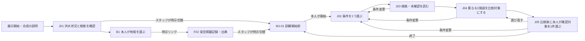

# HINANEX WP-005｜Stage 1 学内MVP完成仕様

2026-11-27 JST · 設計提出 · 2027-02-09 学内発表 · DESIGN_ONLY

D05（MJ-D08）の最低完成ラインは、隔離された固定合成の洪水体験。画面ごとに役割を明示し、架空の洪水状況を確認した利用者が、条件を選び、根拠と未確認事項を読み、2施設を比較して、自分で確認対象を1件選ぶところまでを実演する。D04による#483ソース統合の条件は[工程・決裁](HINANEX_WP005_STAGE2_GATES_20261127.md)で追跡する。[Owner原決裁](https://github.com/1kz-ma1/HINANEX/issues/362#issuecomment-7208106456) · [MJ-D01〜07](https://github.com/1kz-ma1/HINANEX/issues/362#issuecomment-7120366611)

## 1. 完成判定

- 開始時に「架空の洪水訓練」を明示し、状況の取得状態・合成出典・未確認事項を読める。状況確認と施設記録の画面には、MJ-01へ引き継ぐ選択状態を持たせない。
- J02〜J05はMJ-01の同一画面内で進む。明示開始、条件1つ、理由・元値・出典・未確認、異なる2施設、本人の明示選択をすべて観測した時点で完了。比較画面を開いただけの状態は未完了。
- 選択結果には元の `CANDIDATE` / `EXCLUDED` / `UNKNOWN` と根拠を保持する。表示する「本人確認対象」は架空の確認対象であり、安全性・適合・開設・入口・公式指定・経路の判断はすべて範囲外。F07参考経路は「未提供」と説明する。
- 選択と比較を破棄して初期化でき、同じ手順で再開できる。320／390／1440 CSS px、キーボード、隔離実行、失敗時の停止と復旧を[展示・QA計画](HINANEX_WP005_EXHIBIT_QA_20261127.md)の基準で受け入れる。

## 2. 画面遷移と利用者の操作

| 順番 | 利用者の操作と見える結果 | 再利用する画面 |
| --- | --- | --- |
| 0 | スタッフが「固定合成」「画面間の記録は独立」「参考経路未提供」を説明。未選択の初期状態から開始 | ローカルの説明スライドまたは進行カード |
| J01 | 既存の「合成デモ」明示操作で、架空の洪水シナリオ、取得状態、根拠とUNKNOWNを読む。合成表示を確認してから次へ | Frontendの洪水シナリオ表示。状況と根拠の読み方のみを使用 |
| 任意の中継 | B1で地域欄で本人が江戸川区を選択し、loopbackで有効になったリンクからF02へ。架空掲載記録を1件開き、座標なしと未確認、合成出典を示す | B1とF02の既存HTML。地域コード `13123` はこの既存導線に限ったルーティング値 |
| 切替 | 「ここから独立した合成訓練」と案内。閉じたMJ-01をローカルの事前登録URLで開く。利用者が「合成訓練を開始」を押す | スタッフによるブラウザ切替。MJ-01側の状況・条件・比較は未選択 |
| J02〜J03 | 実演は `pet` 固定例を選ぶ。「根拠を確認」を押し、架空3件と出典・未確認を読む。別条件 `step` は再現試験に使用 | #483の固定合成Fixture |
| J04〜J05 | 架空施設A・Bを1件ずつ選択し、2件比較へ。BのUNKNOWNを確認し、本人が「架空施設Bを確認対象にする」を押す。区分は変化しない | MJ-01の既存比較・明示選択。比較と選択はB2の既存モデルを利用 |
| 終了 | 選択結果を読み上げ、既存の終了ボタンでIDLEに戻す。デモ後はタブと一時プロファイルを閉じる | MJ-01と[運転手順](HINANEX_WP005_EXHIBIT_QA_20261127.md) |

J01の初期の通常データ要求はローカルで拒否し、合成デモは本人の明示操作でだけ表示する。ローカルのデモ用ルートは既存 [F01実HTTPテスト](../../frontend/tests/flood-scenario-http-browser.test.cjs) の合成 `flood_shelter_selection` 入力と表示経路を利用候補とする。本番既定の `frontend/mock/region-export.json` には現在そのシナリオがない。B1の `/gis/gis/` 入口は保持し、CDNや公式タイルを参照するため隔離実演では開かない。既存F01表示の隔離成立をWP-006で確認し、未成立時は合成状況・出典・UNKNOWNを含む承認済みのローカル説明カードに手動で切り替える。説明カードで示した範囲を明示する。[既存GIS入口](../../gis/gis/index.html) · [既存合成デモ](../../frontend/mock/region-export.json)

## 3. 提供方式の選択

| 案 | 操作 | 負担・リスク | 判定案 |
| --- | --- | --- | --- |
| A 独立画面の明示切替 | スタッフがローカルランチャーのURLを順に開く。B1→F02だけは既存の本人操作。F02から次の訓練にはスタッフが手動で切り替える | 切替の案内を手順化でき、追加の製品画面や共有状態を要しない。タブ混同は固定タイトル、表示中の確認、終了後の閉鎖で防ぐ | Stage 1の基準案 |
| B 非公開の共通展示ハブ | 「状況を確認」「掲載記録を見る」「合成訓練を開始する」の単純なリンクを置く。子画面の状態を持たず、同一オリジンの固定パスだけ許可。iframe、URLパラメータ、戻り値なし | 展示担当の操作を簡単にできる。新規HTML・配布除外の実パス証明・キーボード・リンク負例・ステージ切戻しの追加QAを要する | Aを反復して切替時間・誤操作が課題になった場合に別提案。発表の必須条件から外す |

合成教材の説明は「独立した画面で、同じ洪水訓練の考え方を順に体験する」。J01用合成入力、F02用合成掲載記録、MJ-01の固定Fixtureは別ファイル・別ID空間とし、展示版manifestに各ソース、バイトSHA-256、画面で見せるケース名を記録する。F02は既存#498の実HTMLと2件の合成RegionExportを再利用候補とする。名前が似ても同一施設と説明しない。地域・施設ID・位置・安全性・選択をURL、cookie、ストレージ、メッセージ等で受け渡さない。[#498](https://github.com/1kz-ma1/HINANEX/pull/498) · [B1受入メモ](../../frontend/docs/F05_MINIMAL_JOURNEY_20261113.md)

## 4. 再利用と次工程の追加候補

調査基準のmainは `4fc17aa056c5a13e2611aa9188bd61fda75484f3`。MJ-01は #483 `4612c2e6cb5d5e40a6f22bd030b39f2f7f738f9f` を参照する。展示版には後続判定で許可された固定版を採用する。

| 機能 | 既存成果の利用 | 追加候補・制約 |
| --- | --- | --- |
| F01／F13 | Frontendの合成状態、理由・出典・UNKNOWN表示をJ01に利用。F13の設計から取得失敗、未取得、未確認を区別する | 承認済み合成デモ入力と隔離ルートの固定のみ。GISのF13 #436は未統合。地図・タイルとF13追加UIを必須に置かない。[#436](https://github.com/1kz-ma1/HINANEX/pull/436) |
| B1／F02 | #371・#498の本人地域選択・loopback手動遷移、実F02の合成記録検索と出典を再利用 | F02専用合成JSONを許可リストに登録。取得失敗時は本人再取得または明示切替。現在の公式データや実施設座標を取り込まない。[F02仕様](../../frontend/docs/F02_REGION_EXPORT_CONSUMER_20261111.md) |
| B2／MJ-01 | 既存B2モデルをMJ-01が再利用。#483のJ02〜J05、2件制限、UNKNOWN保持、実AXとリセットを中心に置く | B2の別画面を経由せず、S0/S1プロバイダは設定しない。必要なのは展示版固定・接続境界と通しQA。[B2仕様](../../frontend/prototypes/f05-flood-journey/b2-compare/README.md) · [#483検証](https://github.com/1kz-ma1/HINANEX/pull/483#issuecomment-7208069914) |
| F04 | 架空の時間経過を説明する補助資料の候補 | #430/#432はDraft。中心実演に入れず、独立した非公開運転が成立した場合だけ質疑向けに評価。[#430](https://github.com/1kz-ma1/HINANEX/pull/430) · [#432](https://github.com/1kz-ma1/HINANEX/pull/432) |
| F09 | 非公開の備え確認を、時間に余裕がある場合の質疑用候補にする | #429は統合済み。今回の7分枠から外し、D05の対象や別途展示許可に含まれるか確認してから扱う。[#429](https://github.com/1kz-ma1/HINANEX/pull/429) |
| F17 | 明示開始・終了、架空性の見せ方の参考 | #438は統合済み。別の訓練状態を持つため中心枠では起動せず、別途承認時に質疑で説明する。[#438](https://github.com/1kz-ma1/HINANEX/pull/438) |

## 5. 状態破棄と再開

| イベント | 遷移・残すもの | 確認する観測 |
| --- | --- | --- |
| 比較から選び直し | J04へ。現在条件は保持し、比較と本人選択を消去 | 0/2、旧選択なし、再選択が必要 |
| 条件変更 | J02へ。条件・結果・比較・選択を破棄 | 旧DOMの操作を拒否し、旧出典カードが消える |
| 模擬取得失敗 | 取得失敗画面へ。旧結果・比較・選択を破棄。再開は本人開始 | 失敗表示と初期状態、暗黙の合成データ切替なし |
| 終了／実タブ非表示／pagehide・BFCache復帰 | IDLEへ。旧状態なし。復帰で適切なら開始ボタンにフォーカスを戻し、別の接続済み要素のフォーカスを保持 | trustedイベントと状態を記録。実BFCacheは `pageshow.persisted=true` が条件 |
| 独立画面の切替・次の来場者 | F02では記録選択を解除して画面を閉じる。MJ-01は既存終了を使い、次の来場者へは新しい一時セッション | URL・履歴から旧条件や本人選択が復元されない。失敗時は[復旧手順](HINANEX_WP005_EXHIBIT_QA_20261127.md)へ |
